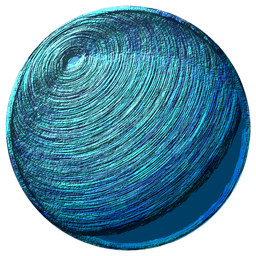
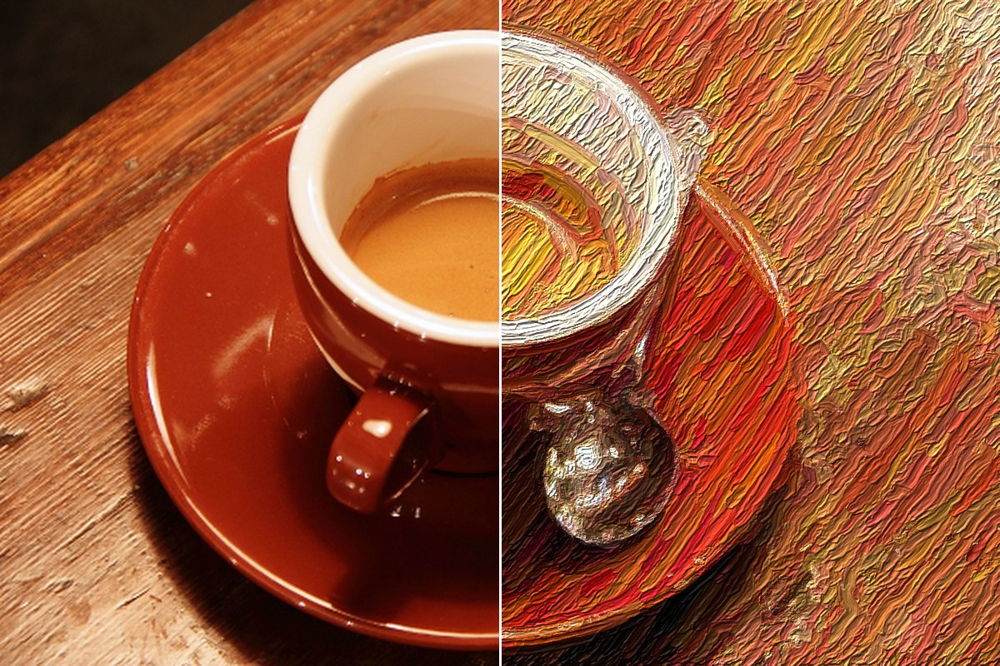
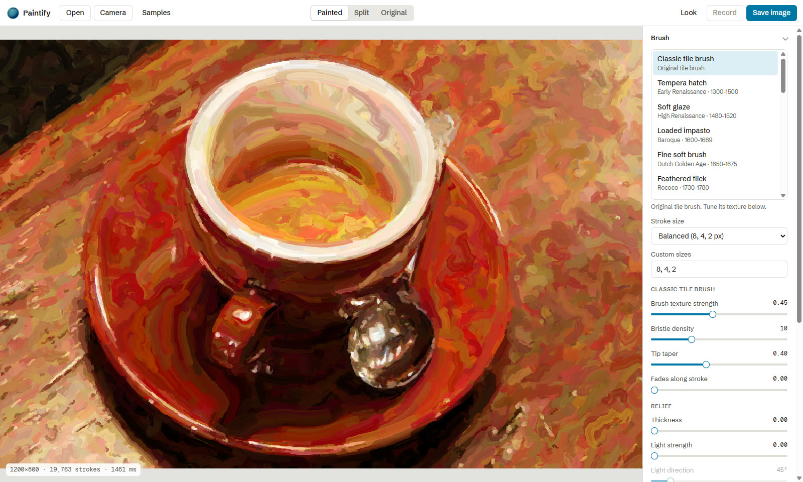
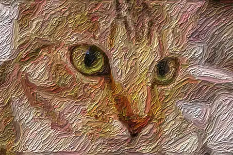
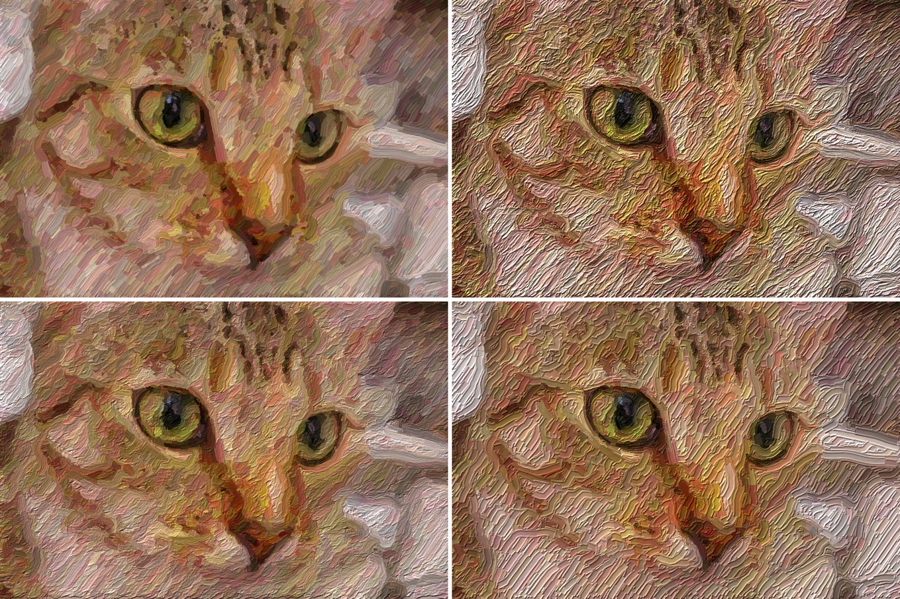
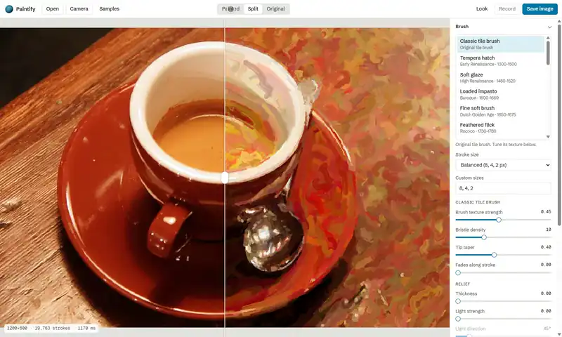

  

<h1 align="center">Paintify for the web</h1>

  <b>Turn photos, videos and your camera into paintings, live in your browser.</b> 
  Painted brushstrokes, designed for motion.

  <a href="https://paintify.shivav.com/"><b>Open Paintify</b></a>

  

## Nothing to install

Open the page, drop in a photo or a video, or turn on your camera, and watch it painted stroke by stroke. Paintify follows the shapes and edges of your picture with a brush and lays paint down coarse to fine, the way a painter blocks in a canvas and then works up the detail. It all runs on your graphics card through WebGPU, so it is fast and private: nothing you open leaves your computer.

   
  <a href="docs/media/demo.mp4"><b>▶ Watch the 40-second demo</b></a>: open a sample, compare with the split view, switch brushes, paint a video.

Switch to **Split** to drag a wipe between the original and the painting:

  

  

## Made for motion

Play a video or point your camera and it is painted as it moves. Steady strokes keep the paint still where nothing moves, so footage doesn't flicker. When it looks right, export the whole video as an MP4, every frame painted, or record the camera as you go.

## Pick a brush

More than twenty brushes inspired by the history of painting: Van Gogh's rhythmic ridges, Monet's broken colour, Seurat's dots, Cézanne's flat hatching, a palette knife, watercolour, ukiyo-e, sumi-e and more. Then shape the look with stroke size, length, curvature, paint thickness and lighting. A split view shows the original and the painting side by side as you work.

  

Each brush repaints the canvas the moment you pick it:

  

## What you need

A current Chrome, Edge or Arc on Mac, Windows or ChromeOS, or Safari 26. Paintify needs a graphics card with WebGPU, which every recent desktop and laptop has.

---

Paintify is MIT licensed (<a href="LICENSE">LICENSE</a>). Developers: see <a href="docs/BUILDING.md">building for the web</a>. Example photos: Chelsea the cat (Stefan van der Walt) and espresso cup (Rachel Michetti), both CC0; Falcon 9 launch (SpaceX), public domain. Fonts: Schibsted Grotesk and Geist Mono, SIL OFL 1.1. MP4 muxing: mp4-muxer, MIT.
