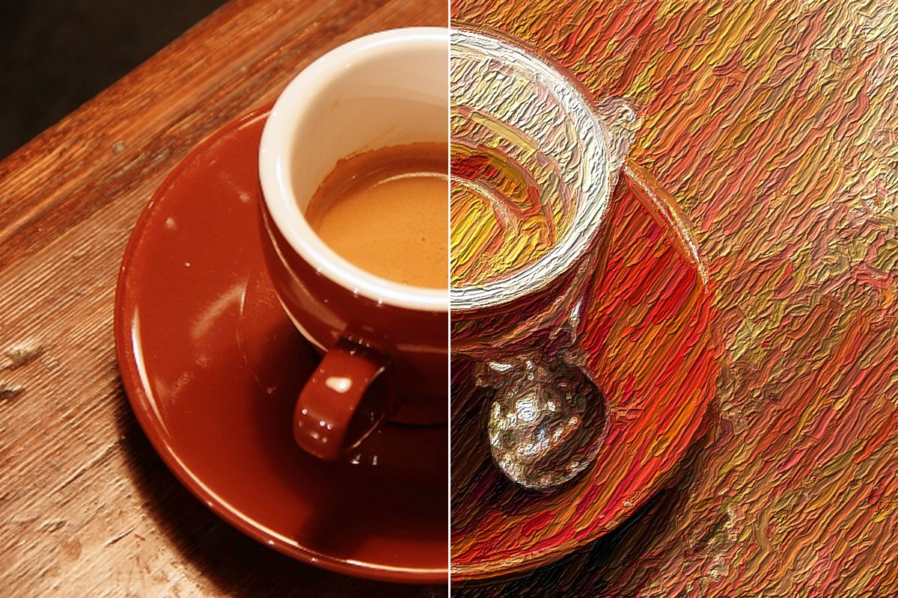
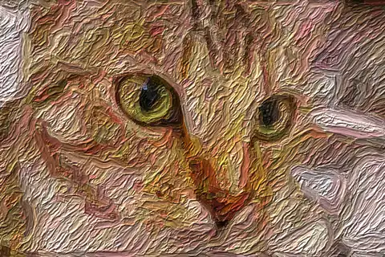
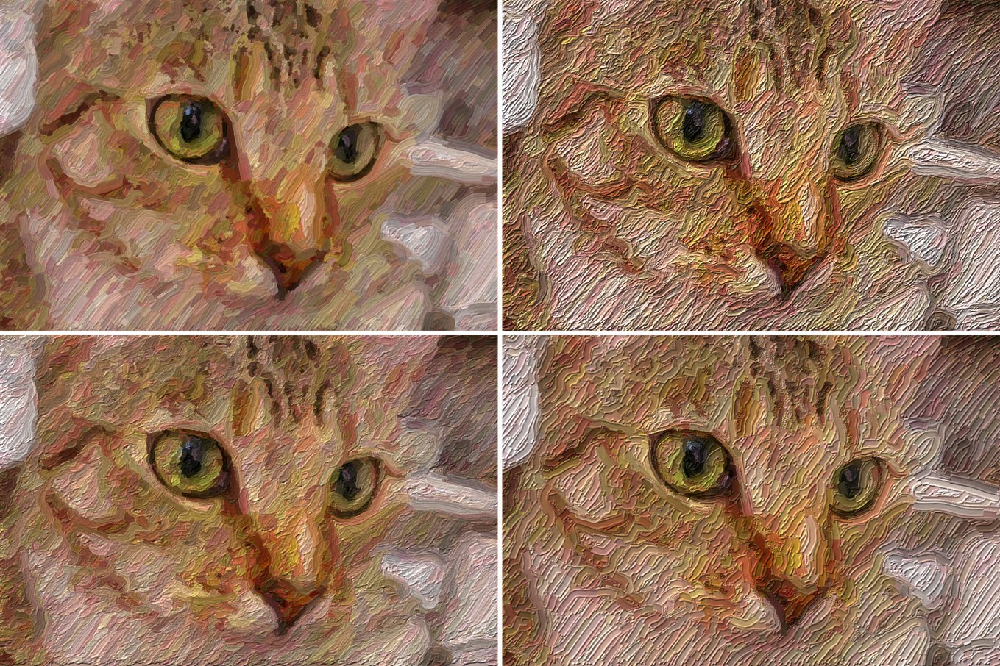

  

<h1 align="center">Paintify for the web</h1>

  <b>Turn photos, videos and your camera into paintings, live in your browser.</b> 
  Painted brushstrokes, designed for motion.

  <a href="https://brownbearr.github.io/paintify-web/"><b>Open Paintify</b></a>

  

## Nothing to install

Open the page, drop in a photo or a video, or turn on your camera, and watch it painted stroke by stroke. Paintify follows the shapes and edges of your picture with a brush and lays paint down coarse to fine, the way a painter blocks in a canvas and then works up the detail. It all runs on your graphics card through WebGPU, so it is fast and private: nothing you open leaves your computer.

  

## Made for motion

Play a video or point your camera and it is painted as it moves. Steady strokes keep the paint still where nothing moves, so footage doesn't flicker. Export a silent painted MP4, or record the camera as you go (MP4 or WebM, depending on your browser). File export samples an estimated 10–60 fps, with a 30 fps fallback; it does not preserve audio or exact source timestamps. It can take longer than playback and holds the encoded file in memory. Use a smaller processing size for long videos. A supported WebCodecs encoder is required; Paintify reports unavailable configurations.

## Pick a brush

More than twenty brushes inspired by the history of painting: Van Gogh's rhythmic ridges, Monet's broken colour, Seurat's dots, Cézanne's flat hatching, a palette knife, watercolour, ukiyo-e, sumi-e and more. Then shape the look with stroke size, length, curvature, paint thickness and lighting. A split view shows the original and the painting side by side as you work.

  

## What you need

A current Chrome, Edge or Arc on Mac, Windows or ChromeOS, or Safari 26. Paintify needs a graphics card with WebGPU, which every recent desktop and laptop has.

---

Developers: see <a href="docs/BUILDING.md">building for the web</a>. Example photos: Chelsea the cat (Stefan van der Walt) and espresso cup (Rachel Michetti), both CC0; Falcon 9 launch (SpaceX), public domain. Fonts: Schibsted Grotesk and Geist Mono, SIL OFL 1.1. MP4 muxing: mp4-muxer, MIT.
